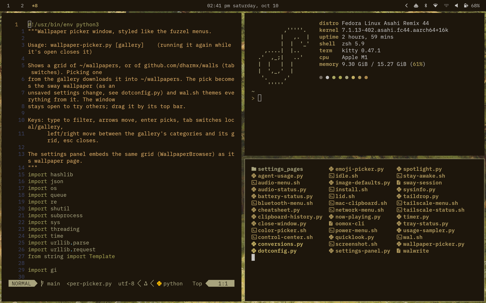
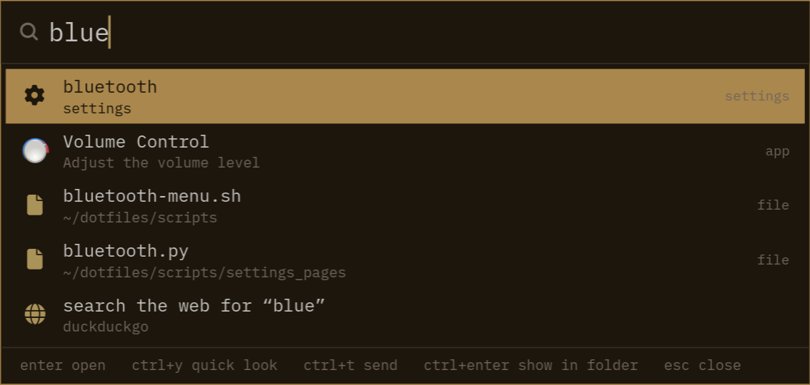
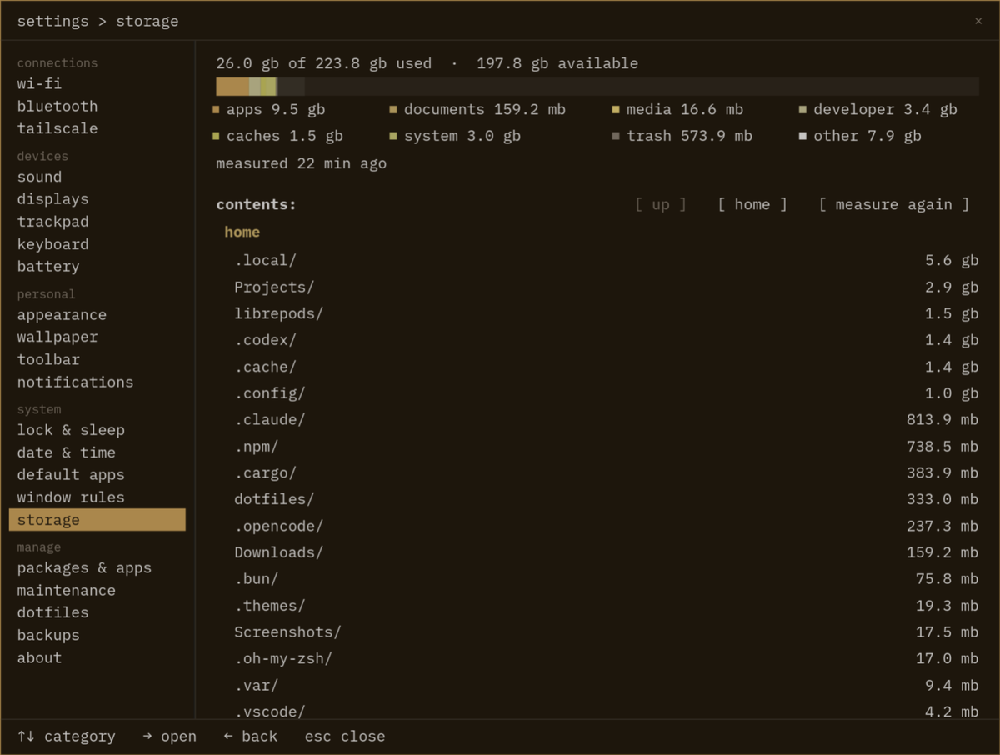
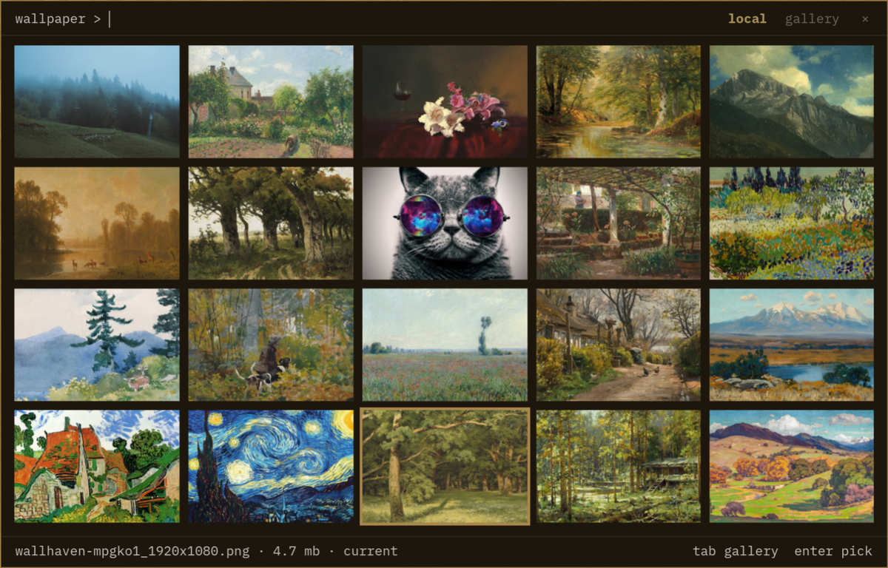
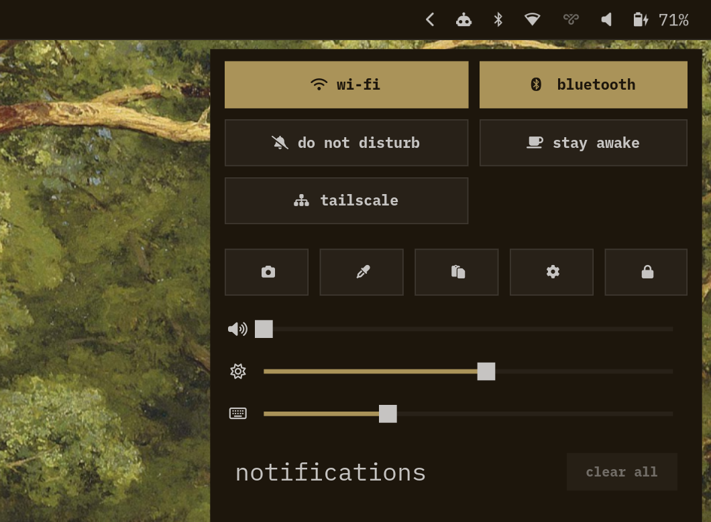
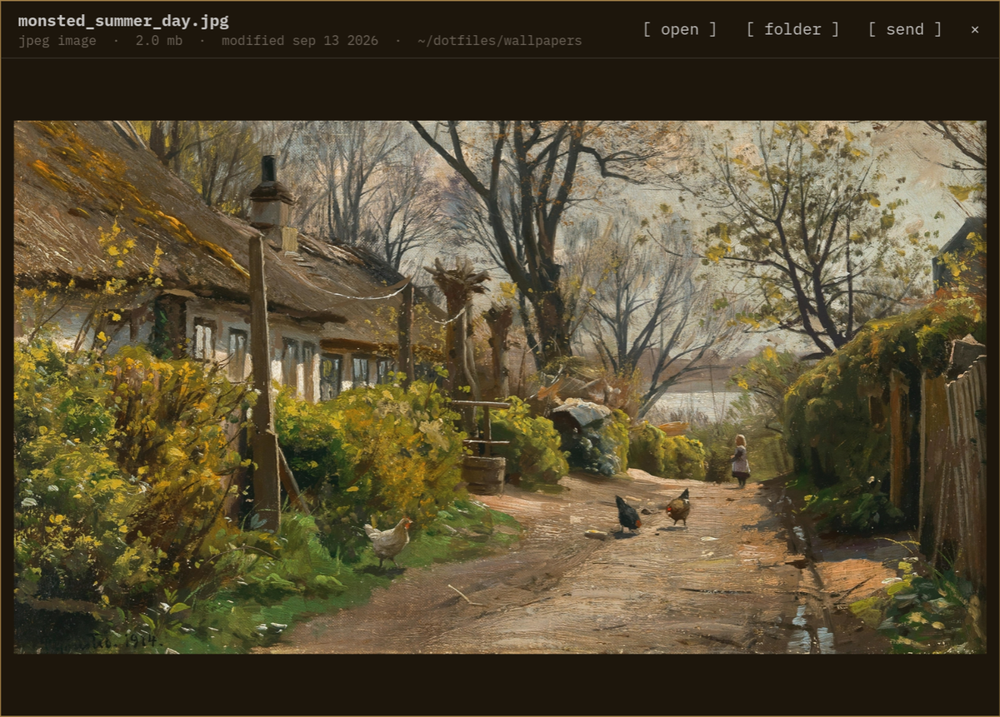
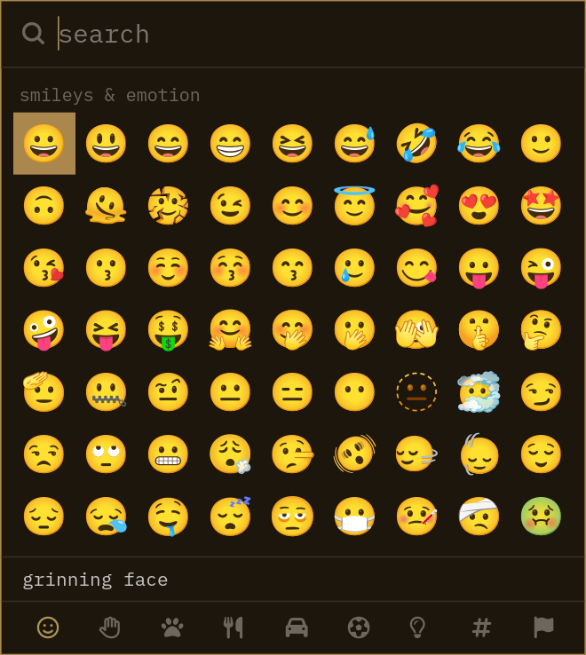
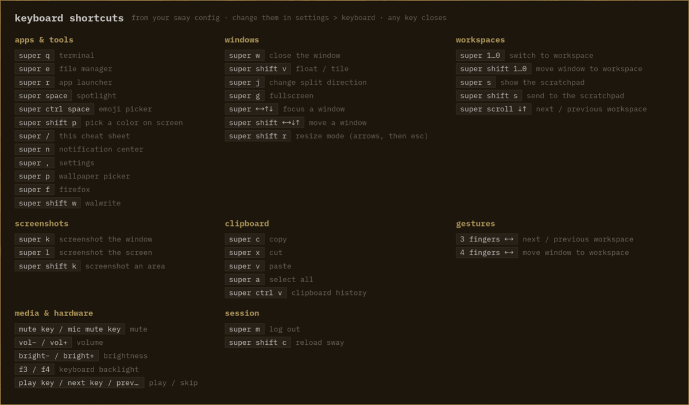
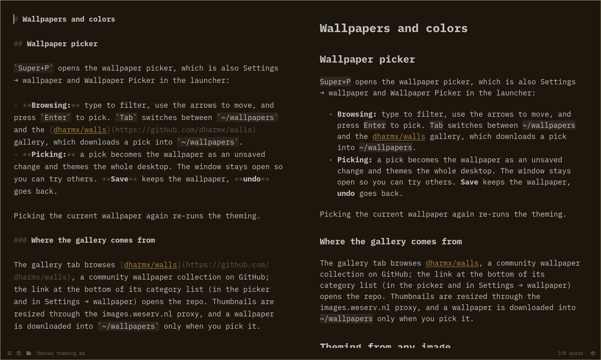

<h1 align="center">Asahi dotfiles</h1>

<p align="center">
  A Sway desktop for Fedora Asahi Remix on an Apple Silicon MacBook, set up to feel like home coming from macOS.<br>
  Colors come from the wallpaper and follow it everywhere, and shortcuts use Command the way macOS does.
</p>

<p align="center">
  <a href="docs/installation.md">Install</a> ·
  <a href="docs/shortcuts.md">Shortcuts</a> ·
  <a href="docs/settings.md">Settings</a> ·
  <a href="docs/theming.md">Theming</a> ·
  <a href="docs/README.md">All docs</a>
</p>

<p align="center">
  
</p>

## Highlights

The desktop comes with its own Spotlight, Quick Look, emoji picker, settings app, wallpaper picker, clipboard history and Markdown editor, all styled to match the wallpaper.

<table>
  <tr>
    <td width="50%" align="center">
      
      <br><b><a href="docs/apps.md#spotlight">Spotlight</a></b><br>
      <sub>Apps, files, settings, math, conversions, and timers from <code>Super+Space</code></sub>
    </td>
    <td width="50%" align="center">
      
      <br><b><a href="docs/settings.md">Settings</a></b><br>
      <sub>Wi-Fi, Bluetooth, battery history, storage, packages, and more, with undoable changes</sub>
    </td>
  </tr>
  <tr>
    <td align="center">
      
      <br><b><a href="docs/theming.md">Wallpaper picker</a></b><br>
      <sub>Pick a wallpaper and the whole desktop re-themes around it</sub>
    </td>
    <td align="center">
      
      <br><b><a href="docs/desktop.md#control-center">Control Center</a></b><br>
      <sub>Quick toggles, sliders, now playing, and notifications</sub>
    </td>
  </tr>
  <tr>
    <td align="center">
      
      <br><b><a href="docs/apps.md#quick-look">Quick Look</a></b><br>
      <sub>Preview images, code, PDFs, and video without opening an app</sub>
    </td>
    <td align="center">
      
      <br><b><a href="docs/apps.md#emoji-picker">Emoji picker</a></b><br>
      <sub>Search, skin tones, and your favorites on top</sub>
    </td>
  </tr>
  <tr>
    <td align="center">
      
      <br><b><a href="docs/shortcuts.md">Shortcut cheat sheet</a></b><br>
      <sub><code>Super+/</code> shows every binding, read live from the Sway config</sub>
    </td>
    <td align="center">
      
      <br><b><a href="docs/walwrite.md">Walwrite</a></b><br>
      <sub>A Markdown editor with live preview and autosave</sub>
    </td>
  </tr>
</table>

## What's included

- **Desktop:** Sway with autotiling, Waybar, Fuzzel, SwayNC, SwayOSD, swaylock, and swayidle, with greetd and tuigreet to log in
- **Terminal and editor:** Kitty, Zsh with Powerlevel10k, and Neovim based on Kickstart
- **Theme:** pywal16 colors from the wallpaper, carried into GTK 3 and 4, Firefox, btop, and every app here
- **Font and cursors:** BlexMono Nerd Font and Rosé Pine cursors

The [full list](docs/installation.md#whats-included) has every tool.

## Installation

```sh
git clone https://github.com/dblopez04/asahi-dotfiles.git ~/dotfiles
cd ~/dotfiles
bash scripts/install.sh
```

> [!WARNING]
> Read the [installer](scripts/install.sh) and back up your existing configs before you run it. It installs packages and changes system settings. [What it does](docs/installation.md) lists everything.

## Documentation

- [Installation](docs/installation.md): what the installer does, its options, and what to do afterwards
- [Keyboard shortcuts](docs/shortcuts.md): every shortcut and trackpad gesture
- [Control Center and status bar](docs/desktop.md): quick toggles and every Waybar module
- [Settings](docs/settings.md): every page, unsaved changes and backups, and battery history
- [Wallpapers and colors](docs/theming.md): the wallpaper picker, its gallery, and how theming works
- [Apps](docs/apps.md): Spotlight, Quick Look, Taildrop, screenshots, the emoji picker, and clipboard history
- [Walwrite](docs/walwrite.md): the Markdown editor
- [Idle, lid, and sleep](docs/power.md): lock and sleep timers, the lid, and stay awake
- [Repository layout](docs/layout.md): where everything lives
- [Customization and troubleshooting](docs/customization.md): adapting it to your machine, and common fixes
